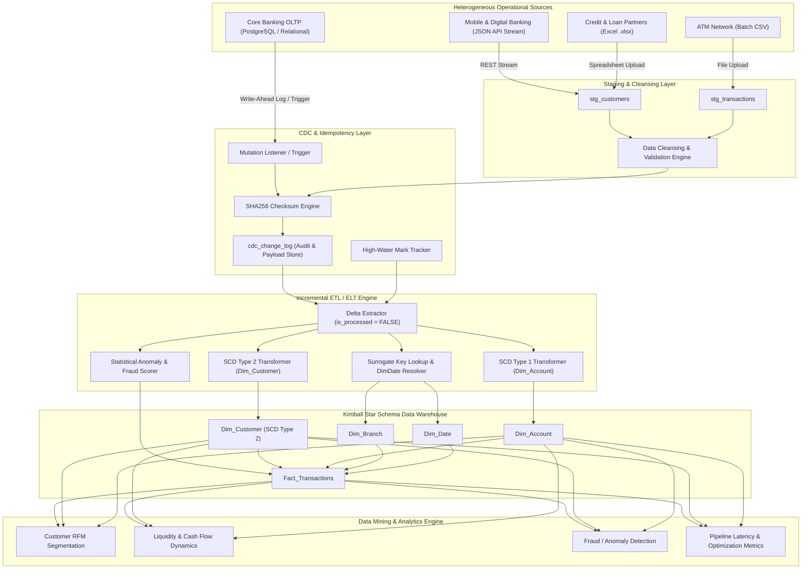
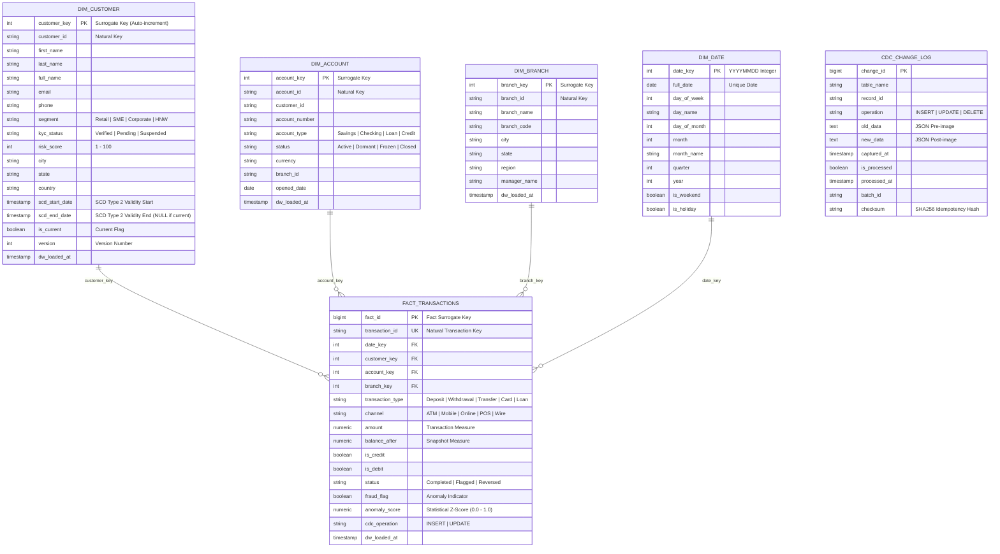

# System Architecture & Data Flow Specification

## 1. Project Overview & Objective
**Title:** ETL/ELT Pipeline Optimization for Heterogeneous Sources via Change Data Capture (CDC) Based Incremental ETL, Applied to Banking Customer Transaction Warehousing Systems.

**Domain:** Data Engineering, Data Warehousing, Data Mining & Financial Analytics.

**Core Problem Statement:**
Traditional banking data warehouses employ scheduled batch Full Reload ETL pipelines that re-extract all historical data. In large transactional banking environments, this leads to:
1. Massive redundant disk I/O and network bandwidth consumption.
2. Long extraction windows that cannot complete within operational nightly batch intervals.
3. Lock contention on core transactional OLTP databases.
4. High warehouse data latency (T+1 day delay), preventing real-time fraud and liquidity monitoring.

**The Solution:**
This system captures row-level mutations (`INSERT`, `UPDATE`, `DELETE`) as they occur using **Change Data Capture (CDC)**, calculates deterministic cryptographic checksums for idempotency, normalizes heterogeneous data formats (CSV, JSON, SQL, Excel) into a transient staging layer, applies **Slowly Changing Dimensions (SCD Type 2)**, and incrementally loads only changed records into a centralized Kimball Star Schema Data Warehouse.

---

## 2. High-Level Data Flow Diagram

---

## 3. Entity-Relationship Diagram (ERD) - Kimball Star Schema

